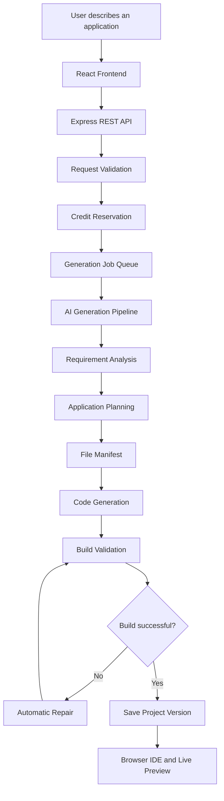
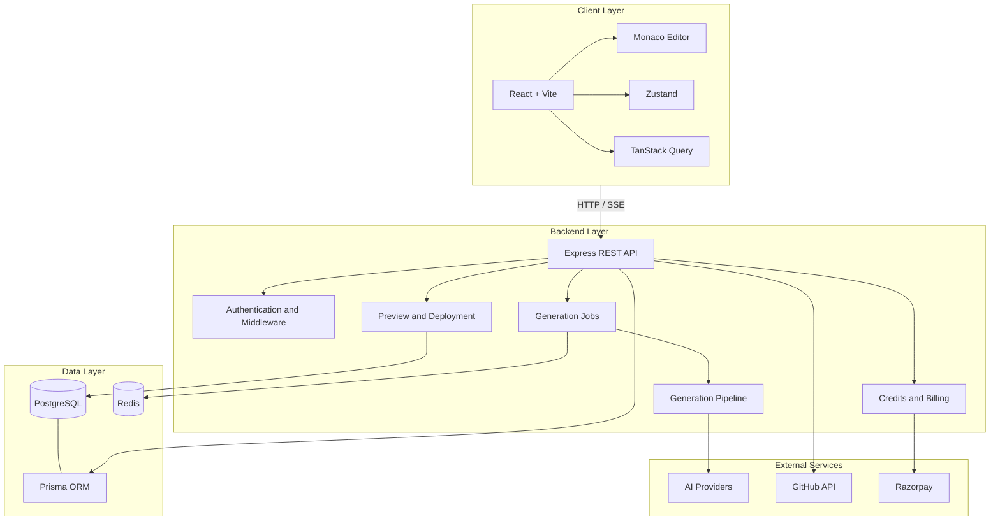

# WebCraft

**From an idea to a working application. Describe it. Generate it. Edit it. Ship it.**

WebCraft is an AI-powered application generation platform that transforms natural-language prompts into editable React applications. It combines AI-assisted code generation, an in-browser development environment, live previews, project management, and deployment workflows in one platform.

Instead of starting with an empty codebase, users describe the application they want to build. WebCraft analyses the requirements, plans the application structure, generates the required files, validates the build, and provides an interactive workspace where users can continue developing their project.

---

## Table of Contents

- [Overview](#overview)
- [Key Features](#key-features)
- [How WebCraft Works](#how-webcraft-works)
- [System Architecture](#system-architecture)
- [Technology Stack](#technology-stack)
- [Project Structure](#project-structure)
- [Getting Started](#getting-started)
- [Environment Configuration](#environment-configuration)
- [AI Provider Configuration](#ai-provider-configuration)
- [Generation Pipeline](#generation-pipeline)
- [API Reference](#api-reference)
- [Database Design](#database-design)
- [Preview and Deployment](#preview-and-deployment)
- [Credits, Billing and BYOK](#credits-billing-and-byok)
- [GitHub Integration](#github-integration)
- [Authentication and Security](#authentication-and-security)
- [Testing](#testing)
- [Troubleshooting](#troubleshooting)
- [Known Limitations](#known-limitations)
- [Contributing](#contributing)
- [License](#license)

---

## Overview

WebCraft aims to simplify application development by bringing AI-assisted generation and traditional development workflows together.

The platform follows a prompt-to-project workflow:

1. The user describes an application in natural language.
2. The AI analyses the requirements and develops an implementation plan.
3. WebCraft creates a file manifest and generates the application files.
4. The generated project is validated through a production build.
5. If validation fails, the pipeline can attempt targeted repairs.
6. The user enters the browser-based IDE to inspect, edit, and preview the application.
7. The project can be published or synchronized with GitHub.

WebCraft is designed to make application development more accessible without removing the ability to inspect and control the generated code.

## Key Features

### AI-powered application generation

- Convert natural-language descriptions into multi-file React applications.
- Generate project architecture, components, pages, and application files.
- Use a staged generation pipeline with progress reporting.
- Validate generated applications through build checks.
- Support AI-assisted modifications to existing projects.

### Browser-based development environment

- Monaco Editor integration.
- File explorer and editor tabs.
- Create, rename, delete, and search project files.
- AI-assisted project editing.
- Live application preview.
- Terminal and build-log panel.

### Project management

- Create and manage multiple projects.
- Organize projects through the dashboard.
- Archive and delete projects.
- Start projects from predefined templates.

### Templates

Starter templates include:

- SaaS dashboard
- E-commerce store
- Landing page
- Blog and CMS
- Portfolio
- Task manager
- Business website

### Preview and publishing

- Build generated applications in isolated temporary directories.
- Preview actual built application output.
- Publish project snapshots.
- Republish and unpublish deployments.
- View deployment history and roll back to previous versions.

### AI provider integrations

- OpenAI
- Anthropic
- Google Gemini
- Kilo AI Gateway

The provider abstraction allows the application to use different AI services through a common generation interface.

### GitHub integration

- Connect a GitHub account through OAuth.
- Link projects to repositories and branches.
- Create repositories from projects.
- Push and pull project changes.
- Synchronize changes with conflict resolution.

### Accounts and billing

- Email and password authentication.
- JWT-based access and refresh tokens.
- Email verification and password reset.
- Credit-based generation usage.
- Free, Pro, and Business subscription tiers.
- Razorpay payment integration.
- Bring Your Own Key (BYOK) support.

---

## How WebCraft Works

The application follows a client-server architecture.

### Generation workflow



### Request lifecycle

1. The frontend sends a generation request to the backend.
2. The backend validates the request and checks the user's available credits.
3. A generation job is created and queued.
4. The worker executes the generation pipeline.
5. The AI provider generates the application files.
6. The generated application is validated.
7. Project data and version information are persisted through Prisma.
8. The frontend receives job progress and loads the generated project.

Redis and BullMQ support background job processing. An in-memory job mode is also available for local development.

---

## System Architecture



### Architectural components

| Component | Responsibility |
|---|---|
| React client | User interface and application workspace |
| Express API | Request handling and application business logic |
| Generation pipeline | AI-assisted project generation and modification |
| Job processing | Background execution and progress reporting |
| PostgreSQL | Persistent application data |
| Prisma | Database access and schema management |
| Redis | Job queue, caching, and supporting temporary state |
| AI provider adapters | Communication with external AI services |
| Preview service | Building and serving generated applications |
| Billing services | Credit management and payment processing |

---

## Technology Stack

| Layer | Technologies |
|---|---|
| Frontend | React 18, Vite, Tailwind CSS |
| UI and state | Zustand, TanStack Query, Sonner |
| Routing | React Router |
| Code editor | Monaco Editor |
| HTTP client | Axios |
| Backend | Node.js 20+, Express.js |
| Validation | Zod |
| ORM | Prisma |
| Database | PostgreSQL |
| Queue and cache | Redis, BullMQ |
| AI integration | OpenAI, Anthropic, Google Gemini, Kilo AI Gateway |
| Authentication | JWT, bcrypt |
| Payments | Razorpay |
| Version control | GitHub API |
| Testing | Vitest, Supertest, React Testing Library |
| Development infrastructure | Docker Compose |

---

## Project Structure

```text
WebCraft/
│
├── client/
│   └── src/
│       ├── pages/
│       ├── components/
│       │   ├── layout/
│       │   ├── ui/
│       │   ├── brand/
│       │   └── motion/
│       ├── store/
│       ├── lib/
│       └── __tests__/
│
├── server/
│   ├── prisma/
│   │   ├── schema.prisma
│   │   ├── migrations/
│   │   └── seed.js
│   │
│   ├── scripts/
│   └── src/
│       ├── routes/
│       ├── controllers/
│       ├── services/
│       │   ├── generation/
│       │   ├── billing/
│       │   ├── preview/
│       │   ├── deployment/
│       │   └── integrations/
│       ├── lib/
│       │   └── llm/
│       ├── jobs/
│       ├── middleware/
│       ├── repositories/
│       ├── validators/
│       ├── data/
│       │   └── templates/
│       └── __tests__/
│
├── shared/
│
├── docker-compose.yml
├── .env.example
├── package.json
└── README.md
```

### Directory responsibilities

- `client/`: Frontend application, workspace, dashboard, and UI components.
- `server/src/routes/`: API route definitions.
- `server/src/controllers/`: HTTP request handlers.
- `server/src/services/`: Core business logic.
- `server/src/services/generation/`: AI generation pipeline.
- `server/src/lib/llm/`: AI provider adapters, registry, factory, and model configuration.
- `server/src/jobs/`: Background job processing and progress reporting.
- `server/prisma/`: Database schema, migrations, and seed data.
- `shared/`: Shared application constants and schemas.

---

## Getting Started

### Prerequisites

Install the following before running WebCraft:

- Node.js 20 or newer
- npm
- PostgreSQL 14 or newer
- Redis 7 (recommended)
- Docker Desktop (recommended)
- An API key for at least one supported AI provider

**Windows users:** Docker Desktop, Memurai, or WSL are recommended for running Redis. Older Windows Redis builds may not meet BullMQ's requirements.

### 1. Clone the repository

```bash
git clone https://github.com/nVedanshi/WebCraft.git

cd WebCraft
```

### 2. Install dependencies

```bash
npm install
```

### 3. Start the infrastructure

Using Docker Compose:

```bash
docker compose up -d postgres redis
```

The development Docker configuration publishes:

| Service | Port |
|---|---:|
| PostgreSQL | 5432 |
| Redis | 6380 |

If you use externally managed services, configure their connection URLs accordingly.

### 4. Configure environment variables

Create your environment file:

**Windows PowerShell**

```powershell
Copy-Item .env.example .env
```

**Linux / macOS**

```bash
cp .env.example .env
```

Configure your database, authentication secrets, and AI provider credentials.

### 5. Set up the database

```bash
cd server

npx prisma migrate dev

node prisma/seed.js

cd ..
```

### 6. Start WebCraft

From the project root:

```bash
npm run dev
```

The development services are expected at:

| Service | URL |
|---|---|
| Frontend | http://localhost:5173 |
| Backend API | http://localhost:4000/api/v1 |
| Health endpoint | http://localhost:4000/api/v1/health |

---

## Environment Configuration

WebCraft reads configuration from the root `.env` file.

### Database and authentication

| Variable | Description |
|---|---|
| `DATABASE_URL` | PostgreSQL connection string |
| `JWT_ACCESS_SECRET` | Secret used to sign access tokens |
| `JWT_REFRESH_SECRET` | Separate secret used to sign refresh tokens |
| `JWT_ACCESS_TTL` | Access-token lifetime |
| `JWT_REFRESH_TTL` | Refresh-token lifetime |

Generate secure secrets with:

```bash
node -e "console.log(require('crypto').randomBytes(48).toString('hex'))"
```

Use separate values for access and refresh secrets.

### Application configuration

| Variable | Description |
|---|---|
| `PORT` | Backend server port |
| `NODE_ENV` | Application environment |
| `API_VERSION` | API version prefix |
| `CLIENT_URL` | Frontend application URL |
| `FRONTEND_URL` | Frontend URL used by application configuration |
| `CORS_ORIGINS` | Allowed browser origins |
| `RATE_LIMIT_WINDOW_MS` | Rate-limit window |
| `RATE_LIMIT_MAX_REQUESTS` | Maximum requests per window |

### AI providers

| Variable | Description |
|---|---|
| `LLM_PROVIDER` | Active AI provider |
| `OPENAI_API_KEY` | OpenAI API key |
| `ANTHROPIC_API_KEY` | Anthropic API key |
| `GEMINI_API_KEY` | Google AI Studio API key |
| `KILO_API_KEY` | Kilo AI Gateway API key |
| `ANTHROPIC_MODEL` | Anthropic model override |
| `GEMINI_MODEL` | Gemini model configuration |
| `KILO_MODEL` | Kilo model configuration |

### Jobs and infrastructure

| Variable | Description |
|---|---|
| `REDIS_URL` | Redis connection URL |
| `GENERATION_JOBS` | Job execution mode (`BullMQ` or `memory`) |

For Docker Compose, use the Redis port configured in `docker-compose.yml`. The supplied development configuration publishes Redis on port `6380`.

### Credits and payments

| Variable | Description |
|---|---|
| `FREE_DAILY_CREDITS` | Daily free-tier credit allowance |
| `PRO_DAILY_CREDITS` | Daily Pro-tier credit allowance |
| `PRO_MONTHLY_PRICE_CENTS` | Pro subscription price in cents |
| `INR_PER_CREDIT` | INR pricing configuration |
| `RAZORPAY_CURRENCY` | Payment currency |
| `RAZORPAY_KEY_ID` | Razorpay key ID |
| `RAZORPAY_KEY_SECRET` | Razorpay secret |
| `RAZORPAY_WEBHOOK_SECRET` | Webhook verification secret |

### Encryption

| Variable | Description |
|---|---|
| `ENCRYPTION_KEY` | Secret used for encrypting stored provider credentials |

Use a strong, randomly generated encryption key. Never commit secrets or API keys to Git.

### GitHub and email

| Variable | Description |
|---|---|
| `GITHUB_CLIENT_ID` | GitHub OAuth application ID |
| `GITHUB_CLIENT_SECRET` | GitHub OAuth application secret |
| `GITHUB_REDIRECT_URI` | GitHub OAuth callback URL |
| `MAIL_ADAPTER` | Email delivery mode (`dev` or `smtp`) |

---

## AI Provider Configuration

WebCraft uses a provider abstraction to communicate with supported AI services.

The active provider is configured through `LLM_PROVIDER`.

| Provider | Environment variable | Purpose |
|---|---|---|
| OpenAI | `OPENAI_API_KEY` | OpenAI models |
| Anthropic | `ANTHROPIC_API_KEY` | Anthropic models |
| Gemini | `GEMINI_API_KEY` | Google Gemini models |
| Kilo | `KILO_API_KEY` | Models available through Kilo AI Gateway |

Example:

```env
LLM_PROVIDER=openai
OPENAI_API_KEY=your_api_key
```

For Gemini:

```env
LLM_PROVIDER=gemini
GEMINI_API_KEY=your_api_key
GEMINI_MODEL=your_supported_model
```

For Kilo:

```env
LLM_PROVIDER=kilo
KILO_API_KEY=your_api_key
KILO_MODEL=your_supported_model
```

**Important:**

- Use model identifiers supported by your provider account.
- Restart the backend after changing environment variables.
- An operating-system environment variable may override the value in `.env`.
- Provider availability depends on valid credentials and model access.
- Users can configure their own provider credentials through the Integrations section, subject to the application's BYOK support.

To test provider configuration:

```bash
node server/scripts/check-llm.js
```

---

## Generation Pipeline

The generation pipeline is responsible for transforming user prompts into application files.

It is organized into multiple stages:

| Stage | Name | Responsibility |
|---:|---|---|
| 1 | Analysis | Understand the prompt and extract requirements |
| 2 | Planning | Determine pages, components, and application structure |
| 3 | Manifest | Define the files required for the application |
| 4 | Project | Create or load the target project |
| 5 | Files | Generate and persist application files |
| 6 | Build | Validate the generated application |
| 7 | Repair | Attempt targeted fixes when validation fails |
| 8 | Version | Save a project version snapshot |

### Why use multiple stages?

Generating an entire application in one model response can lead to incomplete files, inconsistent architecture, and difficult-to-debug errors.

A staged pipeline separates planning from implementation and provides opportunities to validate and repair generated output.

The pipeline also reports progress so the frontend can communicate the current generation status to the user.

---

## API Reference

**Base URL**

```text
http://localhost:4000/api/v1
```

Protected endpoints require an access token:

```http
Authorization: Bearer <access_token>
```

Successful responses generally use:

```json
{
  "success": true,
  "data": {}
}
```

Error responses generally use:

```json
{
  "success": false,
  "error": {
    "code": "ERROR_CODE",
    "message": "Description of the error"
  }
}
```

### Authentication — `/auth`

| Method | Endpoint | Description |
|---|---|---|
| POST | `/register` | Register a new user |
| POST | `/login` | Authenticate a user |
| POST | `/refresh` | Refresh authentication tokens |
| POST | `/logout` | Invalidate a refresh token |
| GET | `/me` | Retrieve the current user |
| POST | `/forgot-password` | Start password recovery |
| POST | `/reset-password` | Reset a password |
| POST | `/verify-email` | Verify an email address |
| POST | `/resend-verification` | Resend verification email |

### Users — `/users`

| Method | Endpoint | Description |
|---|---|---|
| GET | `/me` | Retrieve profile |
| PATCH | `/me` | Update profile |
| POST | `/me/password` | Change password |
| DELETE | `/me` | Delete account |
| GET | `/export` | Export user data |

### Projects — `/projects`

| Method | Endpoint | Description |
|---|---|---|
| GET | `/projects` | List projects |
| POST | `/projects` | Create a project |
| GET | `/projects/:id` | Retrieve project |
| PATCH | `/projects/:id` | Update project |
| DELETE | `/projects/:id` | Delete project |
| POST | `/projects/:id/archive` | Archive project |

### Project files

| Method | Endpoint | Description |
|---|---|---|
| GET | `/:projectId/files` | List project files |
| GET | `/:projectId/files/*` | Retrieve a file |
| POST | `/:projectId/files` | Create a file |
| PUT | `/:projectId/files/*` | Replace file contents |
| PATCH | `/:projectId/files/*` | Update a file |
| DELETE | `/:projectId/files/*` | Delete a file |

### Generation — `/generation`

| Method | Endpoint | Description |
|---|---|---|
| POST | `/generate` | Generate an application synchronously |
| POST | `/generate/async` | Queue an application generation job |
| POST | `/modify` | Modify an existing project |
| GET | `/jobs/:jobId` | Retrieve job status |
| GET | `/stream/:jobId` | Receive generation progress through SSE |

Generation requests support a prompt and either a new project name or an existing project ID.

### Templates, preview and deployments

| Method | Endpoint | Description |
|---|---|---|
| GET | `/templates` | List templates |
| GET | `/templates/categories` | List template categories |
| GET | `/templates/:id` | Retrieve template details |
| POST | `/templates/:id/use` | Create a project from a template |
| GET | `/preview/:projectId/status` | Retrieve preview status |
| POST | `/preview/:projectId/rebuild` | Rebuild a preview |
| POST | `/deployments/:projectId/publish` | Publish a project |
| POST | `/deployments/:projectId/republish` | Republish |
| POST | `/deployments/:projectId/unpublish` | Unpublish |
| GET | `/deployments/:projectId/status` | Retrieve deployment status |
| GET | `/deployments/:projectId/history` | Retrieve deployment history |
| GET | `/deployments/:projectId/versions` | List deployment versions |

### Integrations — `/integrations`

Provider key management:

- `GET /providers`
- `POST /providers/:provider/key`
- `POST /providers/:provider/test`
- `POST /providers/:provider/default`
- `POST /providers/:provider/billing-mode`
- `DELETE /providers/:provider`

GitHub integration:

- `GET /github/status`
- `GET /github/authorize`
- `GET /github/callback`
- `GET /github/repos`
- `GET /github/repos/:owner/:repo/branches`
- `DELETE /github`

GitHub project operations:

- `POST /github/connect`
- `POST /github/create-repo`
- `POST /github/publish`
- `POST /github/pull`
- `POST /github/sync`
- `POST /github/sync/resolve`
- `GET /github/project/:projectId`
- `GET /github/sync-status/:projectId`
- `DELETE /github/project`

### Billing — `/billing`

The billing API includes endpoints for:

- Credit balance and usage.
- Subscription and pricing information.
- Transaction and payment history.
- Credit purchases.
- Payment verification.
- Subscription creation and cancellation.
- Refund requests.
- Spending limits.
- Payment configuration and webhooks.

---

## Database Design

WebCraft uses PostgreSQL for persistent data storage and Prisma ORM for database access.

The main database models are organized around the following domains:

| Domain | Models |
|---|---|
| Accounts | `User`, `PasswordResetToken`, `ProviderConfig` |
| Projects | `Project`, `ProjectFile`, `ProjectVersion`, `ProjectMember` |
| AI generation | `GenerationJob`, `GenerationArtifact`, `ChatSession`, `ChatMessage`, `LLMUsage` |
| Billing | `Payment`, `Subscription`, `CreditTransaction`, `CreditReservation`, `DailyCreditAllocation`, `PricingModel`, `SpendingLimit`, `WebhookEvent` |
| Templates | `Template`, `TemplateFile` |
| Integrations | `GitHubProject`, `GitHubSyncRecord` |
| Publishing | `Deployment` |

### Project lifecycle

Project status values include:

- `ACTIVE`
- `ARCHIVED`
- `DELETED`
- `PUBLISHED`

### Database management

Run Prisma migrations:

```bash
cd server

npx prisma migrate dev
```

Open Prisma Studio:

```bash
npx prisma studio
```

---

## Preview and Deployment

### Preview system

The preview service builds the generated application rather than displaying a static representation of the source code.

The workflow involves:

1. Writing project files into a temporary directory.
2. Installing project dependencies.
3. Running the production build.
4. Serving the resulting static application output.
5. Caching preview results according to project revision.

Preview builds are executed in separate temporary directories rather than inside the main API process.

### Publishing system

Publishing creates a snapshot of the project and builds it independently.

The deployment workflow supports:

- Publishing a project.
- Republishing updated versions.
- Unpublishing a deployment.
- Viewing deployment history.
- Rolling back to an earlier version.

Published snapshots are designed to remain separate from subsequent edits to the working project.

---

## Credits, Billing and BYOK

WebCraft uses a credit-based model to manage AI generation usage.

### Credit system

- New accounts receive an initial credit allocation.
- Free and paid tiers have configurable daily allowances.
- Purchased credits are maintained separately.
- Generation requests reserve estimated credits before execution.
- Successful jobs consume credits according to usage.
- Failed jobs release their reservations.

### Subscription tiers

| Tier | Description |
|---|---|
| FREE | Free usage with a daily credit allowance |
| PRO | Higher daily allowance and paid subscription |
| BUSINESS | Business-oriented subscription tier |

Actual limits and pricing depend on application configuration.

### Bring Your Own Key (BYOK)

BYOK allows users to provide their own AI provider credentials.

Instead of using platform-managed provider credentials, eligible generation requests can use the user's configured API key.

The intended security model includes:

- Encrypting stored provider credentials.
- Decrypting credentials on the server when needed.
- Keeping provider secrets out of frontend responses.
- Avoiding exposure of API keys in browser-side code.

When BYOK billing mode is active, generation is intended to use the user's provider credentials instead of charging WebCraft platform credits.

### Payments

Razorpay is used for payment processing and subscription-related workflows.

Payment verification and webhook handling are performed server-side.

Payment functionality requires valid Razorpay configuration.

---

## GitHub Integration

WebCraft integrates with GitHub to connect generated applications with external repositories.

### Setup

1. Create a GitHub OAuth application.
2. Configure the OAuth client ID and client secret.
3. Set the callback URL.
4. Open WebCraft's Integrations section.
5. Connect your GitHub account.
6. Select a repository and branch.
7. Link the repository to a project.

### Supported workflows

- Connect GitHub accounts.
- Create repositories.
- Link projects to repositories.
- Push project changes.
- Pull repository changes.
- Synchronize project and repository content.
- Resolve synchronization conflicts.

GitHub OAuth uses a state parameter to protect the authorization flow against CSRF attacks.

---

## Authentication and Security

Security is an important part of WebCraft's backend architecture.

The application includes the following security mechanisms:

| Mechanism | Purpose |
|---|---|
| bcrypt | Password hashing |
| JWT | Access and refresh token authentication |
| Zod | Request validation |
| Helmet | HTTP security headers |
| CORS | Restrict browser origins |
| Rate limiting | Reduce abusive request traffic |
| Ownership checks | Restrict access to user-owned resources |
| Credential encryption | Protect stored provider API keys |
| Build isolation | Keep generated application builds separate from the API process |

### Security recommendations

Before deploying WebCraft publicly:

- Use strong, unique authentication secrets.
- Configure a real encryption key.
- Remove or disable development seed accounts.
- Keep `.env` out of version control.
- Use HTTPS.
- Restrict CORS to trusted origins.
- Keep dependencies updated.
- Avoid logging authentication tokens or provider credentials.

---

## Testing

WebCraft uses Vitest and Supertest for automated testing.

React Testing Library is used for frontend component testing.

Run the test suites from the repository root:

### All tests

```bash
npm test
```

### Backend tests

```bash
npm run test:server
```

### Frontend tests

```bash
npm run test:client
```

### Build and validation

```bash
npm run lint
```

```bash
npm run build:client
```

Testing should cover authentication, project management, generation, billing, provider integrations, previews, deployments, and other core application workflows.

---

## Troubleshooting

### Generation fails or no files appear

1. Check that the configured provider API key is valid.
2. Verify that the selected model is available to your account.
3. Restart the backend after changing `.env`.
4. Check backend logs for generation-stage errors.
5. Run the provider diagnostic script:

```bash
node server/scripts/check-llm.js
```

### Redis connection errors

Verify that Redis is running and that `REDIS_URL` points to the correct port.

For Docker Compose:

```bash
docker compose up -d redis
```

### Running without Redis

For local development, WebCraft supports an in-memory job execution mode:

```env
GENERATION_JOBS=memory
```

This mode is intended for development and does not provide persistent or shared background jobs across server instances.

### Prisma errors on Windows

If Prisma reports an `EPERM` error, stop processes that may be holding the Prisma engine files and rerun the relevant Prisma command.

### Preview build timeout

Increase the preview build timeout through:

```env
PREVIEW_SANDBOX_TIMEOUT_MS=120000
```

### Environment variables not updating

Restart the backend after modifying `.env`.

Also check whether a Windows system environment variable is overriding the value configured in the project.

---

## Known Limitations

The following limitations should be considered when evaluating the current implementation:

- Generated applications currently target frontend React + Vite projects.
- ZIP download functionality is not implemented yet.
- Browser-based end-to-end testing is not included.
- The server build process performs syntax checks rather than a separate bundling step.
- Object-storage configuration is reserved for future integration; current project files are stored in PostgreSQL.
- In-memory job execution is not suitable for multi-instance production deployments.

---

## Contributing

Contributions and improvements are welcome.

1. Fork the repository.
2. Create a feature branch.

```bash
git checkout -b feature/your-feature
```

3. Implement the changes.
4. Add or update tests.
5. Run the test suites.
6. Open a pull request with a description of the changes.

Please do not commit `.env` files, private credentials, or API keys.

---

## License

The root `package.json` declares the MIT license.

For the project to be distributed under the MIT License, include the full MIT license text in a `LICENSE` file at the repository root.

---

**WebCraft — Turning ideas into applications.**
